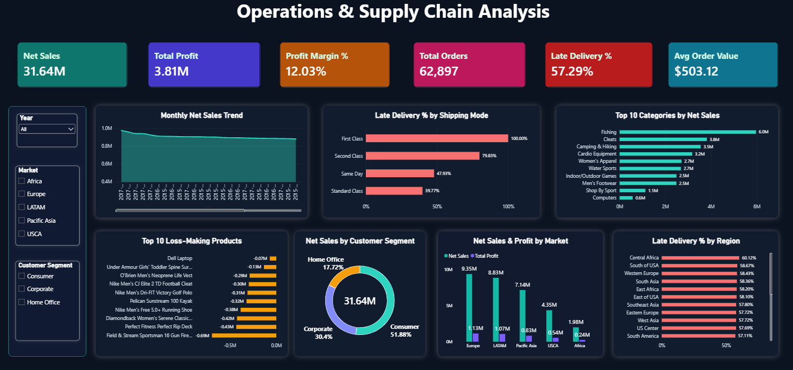

# 📦 Operations & Supply Chain Analysis

**End-to-end data analyst project: MySQL star-schema modelling + Power BI dashboard on 180K+ supply chain order lines.**



---

## 🎯 Business Problem
DataCo Global sells sporting goods worldwide. Leadership needs to know:
1. How much are we selling and how profitable is it?
2. Are we delivering on time, and where do deliveries fail?
3. Which markets, categories and customer segments drive the business?
4. Where are we losing money (loss-making products, fraud, cancellations)?

## 🛠️ Tools & Skills
| Area | Details |
|---|---|
| Database | MySQL 8.0 (Workbench) |
| SQL | Staging tables, data cleaning, star schema, views, CTEs, window functions (`LAG`, `RANK`, moving averages), aggregations |
| BI | Power BI Desktop: Power Query, data modelling (relationships), DAX measures, slicers, custom dark-theme design |
| Dataset | [DataCo Smart Supply Chain (Kaggle)](https://www.kaggle.com/datasets/shashwatwork/dataco-smart-supply-chain-for-big-data-analysis) - 180,519 rows × 53 columns, Jan 2015 - Jan 2018 |

## 🗂️ Project Structure
```
Operations-Supply-Chain-Analysis/
├── data/                 # raw CSVs from Kaggle (not committed - too large)
├── sql/
│   ├── 01_create_and_load.sql      # staging table + LOAD DATA
│   ├── 02_clean_and_model.sql      # star schema, cleaning, validation, views
│   └── 03_analysis_queries.sql     # 10 business questions
├── powerbi/
│   └── supply_chain_analysis.pbix  # dashboard
├── images/
│   └── dashboard.png
└── README.md
```

## 🧱 Data Model (Star Schema)
`fact_orders` (one row per order item) connects to:
`dim_customer` · `dim_product` · `dim_department` · `dim_date`

Key cleaning & modelling decisions
- Loaded raw CSV into `stg_orders`, then split into fact and dimension tables.
- Parsed text timestamps with `STR_TO_DATE`; standardised country `'EE. UU.'` → `'USA'`.
- Dropped duplicate/sensitive columns (masked emails/passwords, duplicate profit and sales columns).
- Derived `delay_days = actual − scheduled shipping days`, `is_late`, `is_cancelled_or_fraud`.
- Created `vw_delivered_orders`, which **excludes cancelled and suspected-fraud orders** so delivery and KPI metrics reflect real fulfilment.
- Validated: 180,519 fact rows, no NULL dates, no orphan customers/products.
- 2018 contains only January, so it is excluded from year-over-year analysis.

## 📊 Headline KPIs (delivered orders, i.e. excluding cancelled & fraud)
| KPI | Value |
|---|---|
| Net Sales | **$31.64M** |
| Total Profit | **$3.81M** |
| Profit Margin | **12.03%** |
| Total Orders | **62,897** |
| Avg Order Value | **$503.12** |
| Late Delivery Rate | **57.29%** |

## 🔍 Key Insights
1. **Over half of all deliveries are late (57.3%).** The problem is systemic: every region sits between ~52% and ~60% late.
2. **Premium shipping is the worst performer.** First Class is **100% late** (promised 1 day, actual 2 days). Second Class is **79.8% late** (promised 2 days, actual about 4). Standard Class, the slowest option, is only **39.8% late** because its 4-day promise is realistic. Same Day is 47.9% late.
3. **Losses almost cancel the profit.** 32,295 order lines (18.7% of delivered lines) lose money, totalling about **$3.71M, almost as much as the $3.81M of total profit**. The biggest losers are the *Field & Stream Sportsman 16 Gun Fire Safe* (≈ −$0.69M), *Perfect Fitness Perfect Rip Deck* (≈ −$0.43M) and *Diamondback Women's Serene Classic Comfort Bike* (≈ −$0.42M).
4. **Sales are flat to declining.** Net sales (all statuses) went from **$11.09M (2015)** → **$11.06M (2016, −0.3%)** → **$10.61M (2017, −4.0%)**. Monthly sales also drop sharply in Nov-Dec 2017 ($0.56M and $0.45M vs ~$0.9-1.0M earlier), which is worth checking for data completeness.
5. **Two markets carry the business.** Europe ($9.35M) and LATAM ($8.83M) generate about **57% of net sales**; Africa is the smallest at $1.98M. Profit follows sales closely in every market (~12%).
6. **Sales are concentrated in a few categories.** Fishing alone is **≈ 19% of net sales (≈ $6.0M)**. The top 3 categories (Fishing, Cleats, Camping & Hiking) make up ≈ 42%, and the top 10 about 90%. Margins are similar everywhere (≈ 11-12.4%), so profit is driven by volume rather than by mix.
7. **Discounts erode profit per item.** Average profit per order line falls from **$26.67 at 0% discount to $17.68 at 20%** and $19.13 at 25%.
8. **Customer segments are equally valuable per head.** Consumer 51.9%, Corporate 30.4% and Home Office 17.7% of sales, but each customer spends about **$1,600** regardless of segment, so growth comes from acquiring more customers, not from targeting one segment.
9. **Order pipeline risk.** Only 33% of order lines are COMPLETE; 22% are stuck in PENDING_PAYMENT. Cancelled and suspected-fraud orders are **4.3% of lines (≈ $1.41M in net sales)**.

## 💡 Recommendations
- **Fix the shipping promise:** reset First Class and Second Class lead times to realistic values, or fix carrier performance, since these modes fail 80-100% of the time.
- **Stop the bleeding on loss-making products:** review pricing, discounting and supplier cost for the top 10 loss-makers. Those 10 products alone account for about $3.5M of losses (SQL Q6, all order statuses), so even partial fixes would move total profit noticeably.
- **Cap deep discounts** on low-margin items; profit per item falls steadily as discount rises.
- **Investigate the Nov-Dec 2017 drop** and the −4% year-over-year decline before planning growth targets.
- **Reduce pending-payment backlog and fraud exposure** to convert more orders into completed revenue.

## 🧾 SQL Highlights (`sql/03_analysis_queries.sql`)
| Query | Question | Technique |
|---|---|---|
| Q1 | Headline KPIs | Aggregations on view |
| Q2 | Yearly sales and YoY growth | CTE + `LAG()` |
| Q3 | Late % by shipping mode | `GROUP BY`, scheduled vs actual days |
| Q4 | Late % by market and region | Multi-column grouping |
| Q5 | Top 10 categories + margin | Join + `RANK()` |
| Q6 | Loss-making products | `WHERE profit < 0` |
| Q7 | Discount vs profit | Group by discount rate |
| Q8 | Monthly trend + 3-month moving average | Window frame `ROWS BETWEEN 2 PRECEDING` |
| Q9 | Segment value + top customers | Distinct counts, ranking |
| Q10 | Order status mix and fraud exposure | `SUM() OVER ()` percentage of total |

## 📐 Dashboard Features
- 6 KPI cards, 7 charts and a filter panel with 3 slicers (Year, Market, Customer Segment)
- DAX measures: `Net Sales`, `Total Profit`, `Profit Margin %`, `Total Orders`, `Late Delivery %`, `Avg Order Value`, `Total Loss`
- Cancelled and fraud orders are excluded inside every measure so numbers match the SQL view

```DAX
Late Delivery % =
DIVIDE(
    CALCULATE(SUM(fact_orders[is_late]), fact_orders[is_cancelled_or_fraud] = 0),
    CALCULATE(COUNTROWS(fact_orders),   fact_orders[is_cancelled_or_fraud] = 0)
)
```

## ▶️ How to Reproduce
1. Download the dataset from Kaggle and place `DataCoSupplyChainDataset.csv` in `data/`.
2. In MySQL Workbench run, in order: `01_create_and_load.sql` (update the file path), `02_clean_and_model.sql`, `03_analysis_queries.sql`.
3. Open `powerbi/supply_chain_analysis.pbix`, click **Transform data → Data source settings**, and point it to your MySQL server and the `supply_chain_db` database.
4. Refresh the report.

> Power BI needs the **MySQL Connector/NET** installed to connect to MySQL.

## 👤 Author
**Irfan** - Aspiring Data Analyst
[LinkedIn](https://www.linkedin.com/) · [GitHub](https://github.com/)
